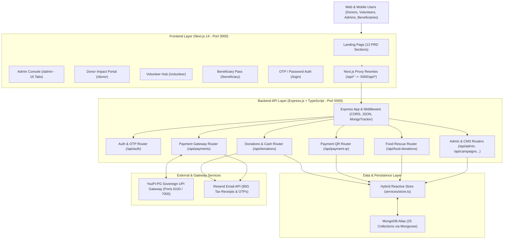
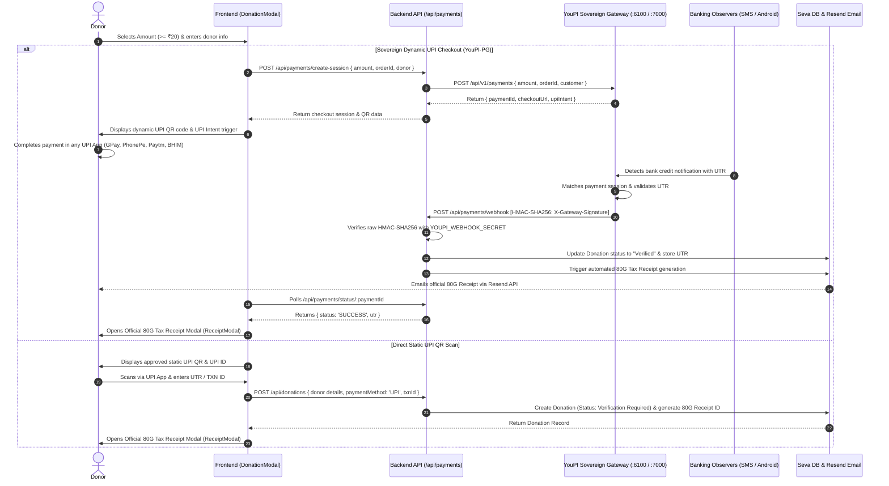

# SEVA Platform — System Architecture & Technical Design

> **Document Type:** System Architecture Specification  
> **Platform Version:** 1.0.0 | **Stack:** Next.js 14, Express.js, TypeScript, Mongoose, MongoDB, Sovereign UPI Gateway (YouPI-PG)

---

## 1. High-Level Architectural Diagram



---

## 2. Monorepo Organization

The project is structured as a cleanly separated monorepo containing:
- **`client/`**: Full Next.js 14 App Router application with React 18 and Tailwind CSS.
- **`server/`**: Standalone Express API built in TypeScript with Mongoose schemas and in-memory fallback.
- **`docs/`**: Comprehensive developer and operational documentation.
- **`package.json`**: Root runner coordinating multi-package development and build scripts.

```
seva-platform/
├── package.json                 # Root script runner (npm run dev:server, dev:client, etc.)
├── README.md                    # Project landing summary
├── docs/                        # Complete technical and architectural documentation
│   ├── README.md                # Documentation index
│   ├── FEATURES_COMPLETED.md    # What is Done Till Now
│   ├── ARCHITECTURE.md          # Technical architecture & design
│   ├── DATABASE_MODELS.md       # 25 Mongoose data schemas
│   ├── API_DOCUMENTATION.md     # 17 REST API route sets
│   ├── ADMIN_GUIDE.md           # Administrator operations manual
│   └── SETUP_AND_DEPLOYMENT.md  # Setup, environment, and deployment
│
├── client/                      # Next.js 14 App Router Frontend
│   ├── .env.local               # Frontend environment variables
│   ├── next.config.mjs          # Proxy rewrites (/api/* -> http://localhost:5000)
│   ├── package.json             # Frontend dependencies
│   ├── tailwind.config.ts       # Tailwind CSS theme configuration
│   ├── tsconfig.json            # Client TypeScript configuration
│   └── src/
│       ├── app/                 # Next.js App Router pages
│       │   ├── layout.tsx       # Root HTML layout with AuthProvider
│       │   ├── page.tsx         # Landing page (13 PRD sections)
│       │   ├── admin/page.tsx   # Admin Console (16 tabs, 5,900+ lines)
│       │   ├── donor/page.tsx   # Donor Impact Portal
│       │   ├── volunteer/page.tsx # Volunteer Operations Hub
│       │   ├── beneficiary/page.tsx # Beneficiary Aid Pass & Enrollment
│       │   ├── login/page.tsx   # Dual OTP & Password login / register
│       │   └── payment-success/ # Post-payment confirmation page
│       ├── components/          # 20+ Reusable UI and Modal components
│       ├── context/             # AuthContext (OTP, login, session refresh)
│       └── lib/                 # Types, utility helpers, and mock baseline data
│
└── server/                      # Express.js + TypeScript Backend
    ├── .env                     # Server environment variables (PORT, MONGO, RZP)
    ├── package.json             # Server dependencies
    ├── tsconfig.json            # Server TypeScript configuration
    ├── vercel.json              # Vercel serverless deployment config
    └── src/
        ├── index.ts             # Express entrypoint, CORS, Mongoose tracker
        ├── config/db.ts         # MongoDB connection manager
        ├── models/index.ts      # 25 Mongoose schema definitions
        ├── routes/              # 17 Express REST API route files
        └── services/store.ts    # Dual-layer reactive store (2,480+ lines)
```

---

## 3. Client Architecture

### 3.1 Next.js 14 App Router
The client leverages React Server Components where appropriate and Client Components (`'use client'`) for dynamic interactive features, form state, and authentication context.

### 3.2 Reverse Proxy Rewrites
To eliminate CORS cross-origin complexities in development and multi-domain deployments, `client/next.config.mjs` proxies all calls matching `/api/:path*` directly to the backend:

```javascript
async rewrites() {
  const rawBackendUrl = process.env.BACKEND_URL || 'http://localhost:5000';
  const backendUrl = rawBackendUrl.replace(/\/+$/, '');
  return [
    {
      source: '/api/:path*',
      destination: `${backendUrl}/api/:path*`,
    },
  ];
}
```

### 3.3 State Management & Context
- **`AuthContext.tsx`**: Provides global authentication state, OTP dispatch, OTP verification, password login, registration, and logout.
- **Silent Background Profile Refresh**: Automatically hits `/api/auth/me?email=...` on mount to ensure field volunteers receive real-time approval status changes without requiring re-login.
- **Local State & Real-Time Sync**: Components fetch live API states on mount and update local state upon modal form completions.

---

## 4. Server Architecture

### 4.1 Express Application Pipeline
The server initializes as an Express application configured with:
1. **Dynamic CORS Matching**: Allows requests from `localhost:3000`, `127.0.0.1:3000`, any `.vercel.app` staging deployment, and non-browser clients (curl, mobile apps, Next.js rewrites).
2. **Serverless Mongoose Operation Tracker (`pendingMongoOps`)**:
   In serverless environments like Vercel, serverless function runtimes can freeze before background asynchronous Mongoose writes complete. The server wraps Mongoose mutation methods (`create`, `insertMany`, `updateOne`, `deleteMany`, etc.) in a `pendingMongoOps` set, and awaits all promises before flushing the HTTP response.
3. **Modular Route Registry**:
   17 distinct route modules mounted under clean REST paths (`/api/auth`, `/api/campaigns`, `/api/donations`, etc.).

---

## 5. Dual-Layer Storage & State Engine

```
                  ┌─────────────────────────────────────────┐
                  │              Incoming API               │
                  └────────────────────┬────────────────────┘
                                       │
                                       ▼
                  ┌─────────────────────────────────────────┐
                  │        SevaServerStore (Singleton)       │
                  │   - Fast In-Memory State & Arrays       │
                  │   - Business Logic & Anti-Fraud Checks  │
                  └────────────┬──────────────────▲─────────┘
                               │                  │
                      Write to │                  │ Read on Init
                      MongoDB  │                  │ & Sync
                               ▼                  │
                  ┌─────────────────────────────────────────┐
                  │         MongoDB Atlas Database          │
                  │    (25 Mongoose Persistent Models)      │
                  └─────────────────────────────────────────┘
```

1. **High Availability**: If MongoDB is momentarily unreachable or no connection string is provided, the platform operates seamlessly without crashing using its built-in reactive memory store.
2. **Persistence**: When MongoDB is connected (`connectDB()`), the server store automatically hydrates from existing MongoDB documents (`syncWithMongoDB()`) and persists all subsequent writes to both in-memory state and MongoDB.
3. **Audit Trail**: Every update, approval, rejection, or deletion triggers an automatic audit entry in `AuditLogModel`.

---

## 6. Payment Processing Flow (Sovereign UPI Gateway / YouPI-PG)



---

## 7. Security, Governance & Anti-Fraud Architecture

1. **Authoritative HMAC-SHA256 Webhook Verification**: YouPI-PG webhooks are cryptographically authenticated via `X-Gateway-Signature` (or `X-YouPI-Signature`) using the shared `YOUPI_WEBHOOK_SECRET` on raw unparsed request payloads before marking any donation as settled.
2. **UPI QR Approval Gate**: Any static QR uploaded by volunteers or field teams enters the database in `Pending` state. The public API `/api/payment-qr` filters by `status === 'Active'`. Only an administrator reviewing Tab 15 can promote it to `Active`.
3. **Strict Minimum Contribution Check**: Enforced at the root schema level (`min: 20`), API route level, and client input validation level.
4. **Food Safety Assurance**: Expired food donations are mathematically rejected by comparing `safeUntil` against the server timestamp.
5. **Capacity Quotas & Role Separation**: Structural guards on user registration prevent rogue escalation into administrative roles without explicit quota clearance (strictly 1 Admin and 4 Volunteers governed under CMS and environment variables, completely separated from the unlimited donor community).

