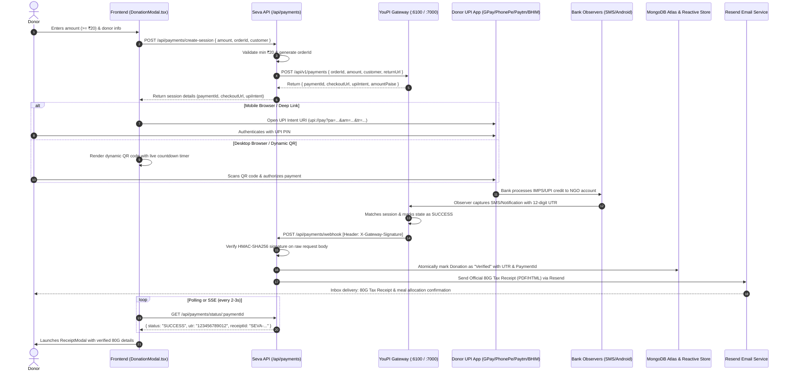

# MASTER PROMPT — Sovereign UPI Payment Integration & Razorpay Deprecation for SEVA Platform

> **Document Type:** Master Implementation & Execution Prompt  
> **Target Project:** SEVA Platform (`seva-platform`)  
> **Gateway Partner:** Sovereign UPI Gateway (YouPI-PG — `C:\Users\soumy\OneDrive\Desktop\youpi-pg`)  
> **Status:** Active Implementation Specification  
> **Currency:** INR (₹) | **Minimum Contribution:** ₹20.00 strictly enforced  

---

## 1. Executive Mission & Context

Act as a Principal Full-Stack Engineer, Payment Security Specialist, and Systems Architect. Your mission is to **completely deprecate and remove the legacy Razorpay integration** from the SEVA Platform and **integrate the Sovereign UPI Payment Gateway (YouPI-PG)** across both backend (`server/`) and frontend (`client/`).

The SEVA Platform is an open community charity and food rescue platform where:
- Donors contribute monetary funds (strictly minimum ₹20 INR) to fund hot meals and emergency relief.
- Donors immediately receive serialized official **80G Tax Exemption Receipts** (`SEVA-DON-2026-XXXXXX` / `SEVA-REC-2026-XXXXXX`) both on screen and via transactional email powered by **Resend**.
- Administrators and Field Volunteers are strictly managed under dynamic CMS governance with fixed environment limits (1 Admin, 4 Volunteers). Donors remain an independent, public, unlimited community.

### Upstream Sovereign Gateway Reference (YouPI-PG)
- **Local Location:** `C:\Users\soumy\OneDrive\Desktop\youpi-pg`
- **Core Payment Service Port:** `http://localhost:6100` (`apps/payment-api`)
- **Checkout Portal / Zero-CORS Proxy:** `http://localhost:7000` (`apps/checkout-portal`)
- **Production Gateway URL:** Configurable via `YOUPI_API_URL`
- **Contract Specification:** `openapi.yaml` (v2.0.0) in `youpi-pg` repository
- **Merchant SDK:** `@youpi/merchant-sdk` (`packages/merchant-sdk/src/client.js`)

---

## 2. Hard Governance Rules & Constraints

1. **Complete Razorpay Removal**:
   - Uninstall the `razorpay` npm package from `server/package.json`.
   - Remove `server/src/routes/razorpay.ts`.
   - Remove `client/src/components/RazorpayPaymentButton.tsx`.
   - Purge all Razorpay script loaders (`checkout.razorpay.com/v1/checkout.js`) and variables (`RAZORPAY_KEY_ID`, `RAZORPAY_KEY_SECRET`, `NEXT_PUBLIC_RAZORPAY_KEY_ID`).
2. **Strict Minimum Amount Enforcement**:
   - The platform strictly rejects any transaction below **₹20.00 INR** at the database schema, Express controller, and React client validation layers.
3. **Cryptographic Webhook Verification**:
   - Never trust frontend redirect callbacks, query parameters, or client-side completion signals as proof of settlement.
   - All donation settlements must be verified server-side using **HMAC-SHA256 signature verification** on the **raw, unparsed request body** against `YOUPI_WEBHOOK_SECRET` via header `X-Gateway-Signature` or `X-YouPI-Signature`.
4. **Idempotency & Deduplication**:
   - Every payment creation must pass an `Idempotency-Key`.
   - Incoming webhook delivery IDs and gateway payment IDs must be deduplicated in the database to prevent duplicate receipt generation or double counting.
5. **No Secret Leaks**:
   - Never place `YOUPI_WEBHOOK_SECRET`, `YOUPI_API_KEY`, or `RESEND_API_KEY` into frontend environment files or client bundles. Only publishable URLs (e.g. `NEXT_PUBLIC_YOUPI_CHECKOUT_URL`) may be exposed to the client.
6. **Preserve Documentation & Codebase Integrity**:
   - Do not alter unrelated features (Admin 16-tab console, Beneficiary Aid Pass, Food rescue flow, quota management).
   - Maintain dual-layer storage compatibility (MongoDB Atlas primary + reactive in-memory store fallback).

---

## 3. End-to-End Architectural Data Flow



---

## 4. Step-by-Step Implementation Roadmap

### Phase 1: Dependency & File Cleanup (Deprecate Razorpay)
1. Run `npm --prefix server uninstall razorpay`.
2. Delete `server/src/routes/razorpay.ts`.
3. In `server/src/index.ts`:
   - Remove `import razorpayRouter from './routes/razorpay';`
   - Remove `app.use('/api/razorpay', razorpayRouter);`
4. Delete `client/src/components/RazorpayPaymentButton.tsx`.
5. In `client/src/components/DonationModal.tsx`:
   - Remove `loadRazorpay` helper and Razorpay checkout script injection.
   - Remove `RazorpayPaymentButton` import and JSX render.
   - Remove `NEXT_PUBLIC_RAZORPAY_KEY_ID` references.

---

### Phase 2: Gateway Integration Service (`server/src/services/payment.ts`)
Create a robust, zero-dependency client service communicating with the YouPI-PG gateway API:

```typescript
import crypto from 'crypto';

export interface CreatePaymentSessionParams {
  orderId: string;
  amount: string; // e.g. "500.00"
  currency?: string;
  customer?: {
    name?: string;
    email?: string;
    phoneNumber?: string;
  };
  metadata?: Record<string, any>;
  returnUrl?: string;
  idempotencyKey?: string;
}

export interface PaymentSessionResult {
  paymentId: string;
  orderId: string;
  amount: string;
  amountPaise: number;
  currency: string;
  status: string;
  checkoutUrl: string;
  upiIntent?: string;
}

export class YoupiPaymentService {
  private apiUrl: string;
  private merchantId: string;
  private webhookSecret: string;
  private apiKey: string;

  constructor() {
    this.apiUrl = (process.env.YOUPI_API_URL || 'http://localhost:6100').replace(/\/+$/, '');
    this.merchantId = process.env.YOUPI_MERCHANT_ID || '00000000-0000-0000-0000-000000000001';
    this.webhookSecret = process.env.YOUPI_WEBHOOK_SECRET || '';
    this.apiKey = process.env.YOUPI_API_KEY || '';
  }

  async createSession(params: CreatePaymentSessionParams): Promise<PaymentSessionResult> {
    const url = `${this.apiUrl}/api/v1/payments`;
    const headers: Record<string, string> = {
      'Content-Type': 'application/json',
      'X-Merchant-Id': this.merchantId,
    };

    if (this.apiKey || this.webhookSecret) {
      headers['X-Merchant-Key'] = this.apiKey || this.webhookSecret;
    }
    if (params.idempotencyKey) {
      headers['Idempotency-Key'] = params.idempotencyKey;
    }

    const res = await fetch(url, {
      method: 'POST',
      headers,
      body: JSON.stringify({
        orderId: params.orderId,
        amount: params.amount,
        currency: params.currency || 'INR',
        customer: params.customer,
        metadata: params.metadata,
        returnUrl: params.returnUrl
      })
    });

    if (!res.ok) {
      const errText = await res.text();
      throw new Error(`YouPI Gateway error [${res.status}]: ${errText}`);
    }

    return await res.json() as PaymentSessionResult;
  }

  async getSessionStatus(paymentId: string) {
    const url = `${this.apiUrl}/api/v1/payments/${paymentId}`;
    const headers: Record<string, string> = {};
    if (this.apiKey || this.webhookSecret) {
      headers['X-Merchant-Key'] = this.apiKey || this.webhookSecret;
    }

    const res = await fetch(url, { headers });
    if (!res.ok) throw new Error(`Fetch payment status failed [${res.status}]`);
    return await res.json();
  }

  verifyWebhookSignature(rawBody: string, signatureHeader?: string): boolean {
    if (!signatureHeader || !this.webhookSecret) return false;
    
    // Header format: "sha256=<hex>" or raw hex
    const cleanSignature = signatureHeader.replace(/^sha256=/, '').trim();
    const computedSignature = crypto
      .createHmac('sha256', this.webhookSecret)
      .update(rawBody, 'utf8')
      .digest('hex');

    return crypto.timingSafeEqual(
      Buffer.from(cleanSignature, 'hex'),
      Buffer.from(computedSignature, 'hex')
    );
  }
}

export const paymentService = new YoupiPaymentService();
```

---

### Phase 3: Express Payment Router (`server/src/routes/payments.ts`)
Implement the new `/api/payments` router supporting session creation, status querying, and raw webhook handling:

```typescript
import { Router, Request, Response } from 'express';
import { paymentService } from '../services/payment';
import { serverStore } from '../services/store';
import { sendEmail } from '../services/email';

const router = Router();

// 1. Create Payment Session
router.post('/create-session', async (req: Request, res: Response) => {
  try {
    const { amount, donorName, donorEmail, donorPhone, campaignId, isAnonymous } = req.body;
    const parsedAmount = parseFloat(amount);

    if (isNaN(parsedAmount) || parsedAmount < 20) {
      return res.status(400).json({ error: 'Minimum contribution is ₹20 INR.' });
    }

    const orderId = `SEVA-ORD-${Date.now()}-${Math.floor(Math.random() * 1000)}`;

    const session = await paymentService.createSession({
      orderId,
      amount: parsedAmount.toFixed(2),
      currency: 'INR',
      customer: {
        name: isAnonymous ? 'Anonymous Donor' : (donorName || 'Generous Supporter'),
        email: donorEmail,
        phoneNumber: donorPhone
      },
      metadata: { campaignId, isAnonymous, platform: 'SEVA' },
      idempotencyKey: `idem_${orderId}`
    });

    // Record initial pending donation in store
    await serverStore.createDonation({
      donorName: isAnonymous ? 'Anonymous Donor' : donorName,
      donorEmail: donorEmail || '',
      donorPhone: donorPhone || '',
      amount: parsedAmount,
      mealsSponsored: Math.floor(parsedAmount / 25),
      paymentMethod: 'UPI',
      transactionId: session.paymentId,
      campaignId: campaignId || 'CMP-1',
      status: 'Pending',
      isAnonymous: Boolean(isAnonymous)
    });

    return res.status(201).json({ success: true, ...session });
  } catch (err: any) {
    console.error('Payment session error:', err);
    return res.status(500).json({ error: err.message || 'Gateway initialization failed.' });
  }
});

// 2. Query Status
router.get('/status/:paymentId', async (req: Request, res: Response) => {
  try {
    const statusData = await paymentService.getSessionStatus(req.params.paymentId);
    return res.json({ success: true, ...statusData });
  } catch (err: any) {
    return res.status(500).json({ error: err.message });
  }
});

// 3. Webhook Listener (Authoritative Settlement)
router.post('/webhook', async (req: Request, res: Response) => {
  try {
    const signature = (req.headers['x-gateway-signature'] || req.headers['x-youpi-signature']) as string;
    const rawBody = (req as any).rawBody || JSON.stringify(req.body);

    const isValid = paymentService.verifyWebhookSignature(rawBody, signature);
    if (!isValid && process.env.NODE_ENV === 'production') {
      return res.status(401).json({ error: 'Invalid cryptographic signature.' });
    }

    const event = req.body;
    if (event.event === 'SUCCESS') {
      const { paymentId, orderId, utr, amount } = event;

      // Find and update donation record
      const allDonations = await serverStore.getDonations();
      const existing = allDonations.find(d => d.transactionId === paymentId || d.transactionId === orderId);

      if (existing) {
        await serverStore.updateDonation(existing.id, {
          status: 'Verified',
          verifiedAt: new Date().toISOString(),
          auditorNotes: `Verified by Sovereign UPI Gateway. UTR: ${utr || 'N/A'}`
        });

        // Trigger official 80G Tax Receipt via Resend Email API
        if (existing.donorEmail) {
          await sendEmail({
            to: existing.donorEmail,
            subject: `Official 80G Tax Exemption Receipt — ${existing.receiptId}`,
            html: `<h2>Donation Confirmed!</h2><p>Dear ${existing.donorName},</p><p>Thank you for contributing ₹${existing.amount}. Your verified 80G Tax Receipt ID is <strong>${existing.receiptId}</strong>.</p><p>Bank Reference (UTR): ${utr || 'Settled'}</p>`
          });
        }
      }
    }

    return res.json({ received: true });
  } catch (err: any) {
    console.error('Webhook processing error:', err);
    return res.status(500).json({ error: 'Internal webhook error.' });
  }
});

export default router;
```

---

### Phase 4: Express Raw Body Preservation Middleware
In `server/src/index.ts`, ensure raw bodies are retained for HMAC-SHA256 signature verification:
```typescript
app.use(express.json({
  verify: (req: any, _res, buf) => {
    req.rawBody = buf.toString();
  }
}));
```

---

### Phase 5: Client-Side UPI Checkout Experience (`DonationModal.tsx`)
Update `client/src/components/DonationModal.tsx`:
1. When donor chooses **"Direct UPI / Dynamic QR"**:
   - Calls `POST /api/payments/create-session`.
   - Obtains `checkoutUrl`, `upiIntent`, and `paymentId`.
2. Renders dynamic UPI QR code (generated via `qrcode.react` or SVG URI) with clear visual steps:
   - Displays dynamic QR for scanning with Google Pay, PhonePe, Paytm, or BHIM.
   - For mobile browsers: displays single-tap button `Open Any UPI App` (`window.location.href = session.upiIntent`).
   - Initiates non-blocking status poll every 2.5 seconds against `/api/payments/status/${session.paymentId}`.
3. Upon receiving `status === 'SUCCESS'`:
   - Transitions modal into celebration screen.
   - Instantly triggers `ReceiptModal` with the official 80G Receipt ID (`SEVA-REC-2026-XXXXXX`).
4. Retains optional **"Manual UPI Transfer"** tab displaying the approved static NGO UPI ID and QR code for manual bank transfers and offline volunteer audits.

---

## 5. Environment Variable Reference

### Backend (`server/.env`):
```env
# Sovereign UPI Payment Gateway (YouPI-PG)
YOUPI_API_URL=http://localhost:6100
YOUPI_MERCHANT_ID=00000000-0000-0000-0000-000000000001
YOUPI_WEBHOOK_SECRET=your_super_secret_webhook_hmac_key_here
YOUPI_API_KEY=your_optional_merchant_api_key_here
YOUPI_CHECKOUT_URL=http://localhost:7000

# Resend Transactional Email API
RESEND_API_KEY=re_your_resend_api_key
RESEND_FROM_EMAIL=SEVA Platform <receipts@seva.ngo>

# Governance Quotas (Strictly enforced)
MAX_ADMINS=1
MAX_VOLUNTEERS=4
```

### Frontend (`client/.env.local`):
```env
# Backend API Target (Rewritten via Next.js proxy)
BACKEND_URL=http://localhost:5000

# Public Sovereign Checkout URL
NEXT_PUBLIC_YOUPI_CHECKOUT_URL=http://localhost:7000
```

---

## 6. Verification Checklist & Quality Gates

| Checkpoint | Validation Criteria | Verification Method |
| :--- | :--- | :--- |
| **CP-1: Dependency Purity** | Zero references to `razorpay` in package manifests or source code. | `grep -rn "razorpay" server/ client/` returns 0 hits. |
| **CP-2: Minimum Donation Floor** | Any donation with amount < ₹20 returns HTTP 400 with descriptive error. | `curl -X POST /api/payments/create-session -d '{"amount":10}'` returns 400. |
| **CP-3: Session Generation** | Gateway initializes session with unique `orderId` and returns valid `checkoutUrl` and `upiIntent`. | Inspect network payload from `create-session`. |
| **CP-4: HMAC Signature Check** | Tampered or unsigned webhooks are rejected with HTTP 401. | Send mock webhook with mismatched signature; verify rejection. |
| **CP-5: 80G Receipt Issuance** | Verified webhook transitions status and generates serialized tax receipt number. | Verify MongoDB donation record has `status: 'Verified'` and non-empty `receiptId`. |
| **CP-6: Email Automation** | Resend API sends donor receipt email containing receipt ID, meal count, and UTR. | Inspect Resend dashboard logs for outbound email. |
| **CP-7: Quota & Role Shield** | Volunteers strictly capped at 4, Admins strictly capped at 1. Donors unaffected. | Registration attempts past quotas are blocked. |

---

## 7. Handover & Execution Command

When prompted to begin implementation:
1. Uninstall Razorpay and remove legacy files.
2. Implement `server/src/services/payment.ts` and `server/src/routes/payments.ts`.
3. Register `/api/payments` in `server/src/index.ts` and enable raw body capture.
4. Refactor `DonationModal.tsx` to mount the Sovereign UPI QR and deep link experience.
5. Verify end-to-end with unit/integration tests and compile builds cleanly (`tsc` and `next build`).
6. Commit to Git and trigger redeployment to Vercel.
